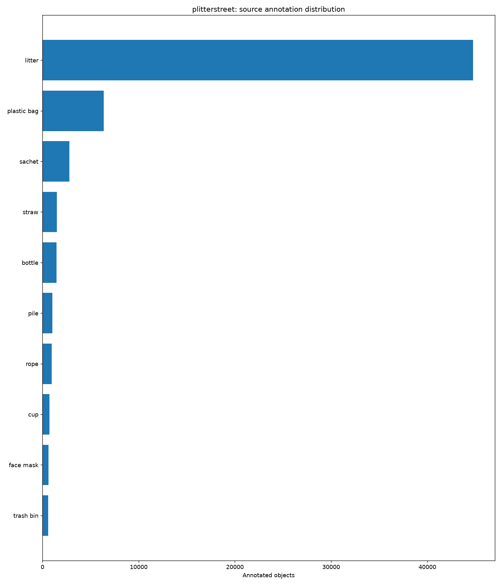
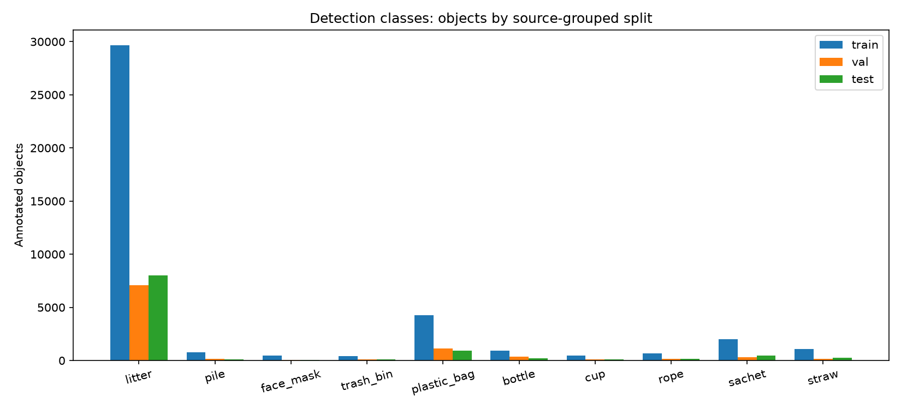
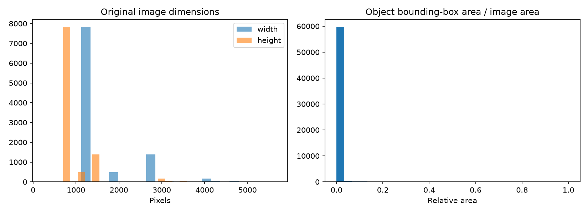
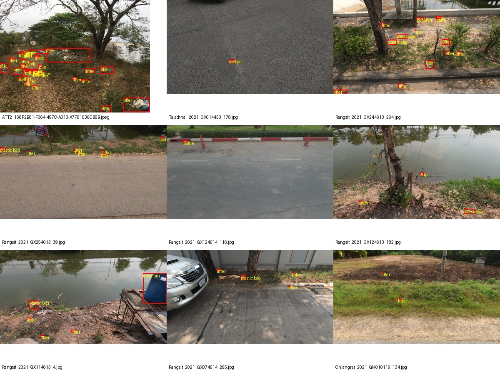

# Phase 1 — Dataset exploration

Status: exploratory; faculty approval pending.

- Original images verified: 10000
- Original annotations: 60826
- Proposed target annotations: 60826
- Images with no selected target class (retained as negatives): 155
- Exact duplicate images: 0
- Boxes clipped to image boundaries: 0
- Split image counts: {'train': 7000, 'val': 1500, 'test': 1500}

## Findings and decisions

All 10,000 selected source images are retained at original resolution. The ten source detection classes are preserved through configs/plitter_classes.json. Images are not duplicated or augmented to reach the count. Negative images remain useful for evaluating false detections. Bottle and cup labels identify object types; they do not certify plastic material.

Class imbalance and small litter objects make per-class precision, recall, and mAP important. No performance value has been assumed. Training-only augmentation changes input appearance and bounding boxes together; no augmented image copies are stored. Feature extraction is learned through the pretrained detector backbone.

Splits keep source-video filename groups together and merge groups linked by exact image duplicates. Whole groups are balanced toward 70/15/15 by image count. This is a grouping proxy, not proof that every related scene is separated. Near-duplicate and visual annotation review are still required. No test-set predictions should guide model tuning.

The public dataset has no verified campus audit locations. It cannot establish campus hotspots or campaign outcomes. The official Zenodo record declares CC BY 4.0. Attribution and faculty approval remain required; approval is pending.

## Figures

## Source annotation identity

The source contains 0 annotation-ID collisions across different images. The pipeline uses the pair (image_id, annotation_id) to preserve every annotation without silently dropping objects. Boundary clipping is recorded separately.

## JPEG preparation

64 source JPEGs do not end with the expected end-of-image marker. The prepared copies append that marker without recompressing pixels or changing resolution. Raw originals and their recorded hashes remain unchanged. This prevents automatic image re-encoding by the training library.
