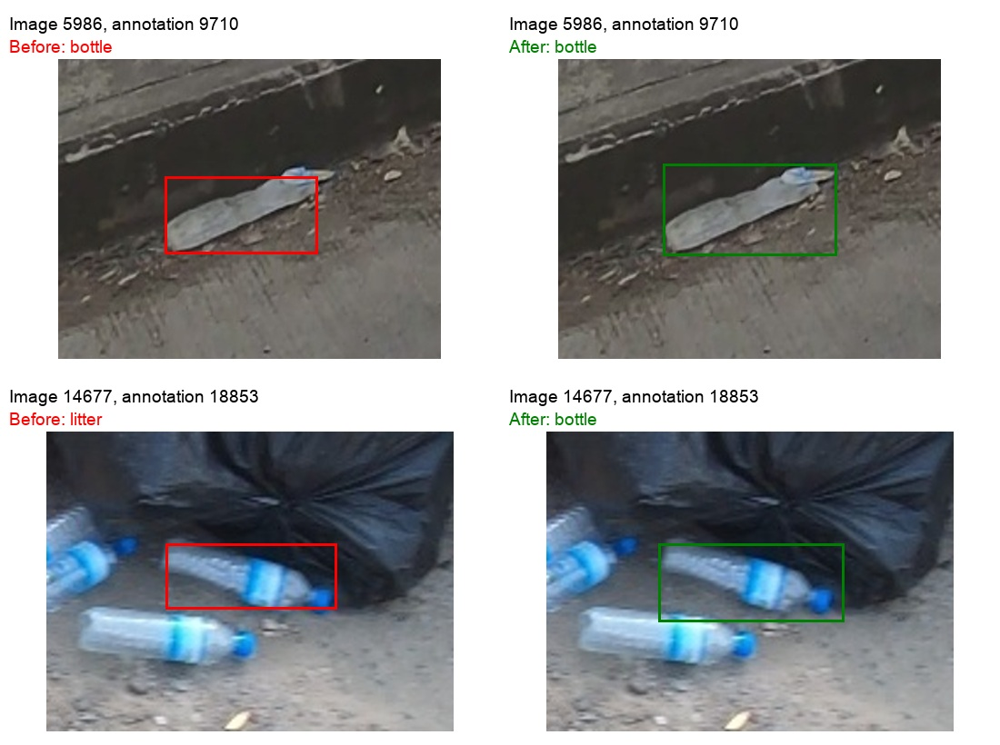

# First training-label refinement pass

Target: **70% validation mAP@50**, an aspiration rather than an achieved result or a guarantee. The current standard-validation YOLO11s result remains approximately 32.2%; this pass did not train a model or measure any new performance.

## Applied in a separate derived version

`data/prepared/plitterstreet-labels-v3` inherits the previous orientation-v2 preprocessing corrections. Raw images, original annotations, original prepared data and both saved models remain preserved. DVC records the new version separately. All 10,000 images and 60,826 object annotations remain present.

| Training image / annotation | Change | Evidence |
| --- | --- | --- |
| 5986 / 9710 | Keep bottle class; expand box from `(203,345,87,44)` to `(202,338,99,52)` | Original box omitted the visible cap/upper body. |
| 14677 / 18853 | Change residual litter to bottle; adjust box from `(755,462,70,27)` to `(752,462,76,32)` | Visible transparent labelled bottle with a blue cap, consistent with adjacent bottles. |

Coordinates above are source-pixel `(x,y,width,height)` for these non-rotated training images. Exact old/new categories and coordinates, source identities, review rationale and held cases are retained in `configs/label_corrections_v3.json`. The patch is AI-assisted visual annotation, not expert-certified ground truth or material verification.

## Deliberately unresolved

The overlapping bottle group (14677 / 18846) still needs individual-instance adjudication. Several bottles are visible, but hidden boundaries are not clear enough to introduce confident new boxes. The purple-ended object remains bottle because the end may be a cap. Yellow flattened packaging, the crushed blue printed cup example and the orange fragments remain unchanged. All validation/test audit flags remain unapplied.

These decisions supersede any earlier suggestion to automatically split the grouped box or relabel the purple-ended object. Uncertainty is retained explicitly; a target score is not a reason to invent labels or remove hard cases.

## Verification

- Only two training label files differ from orientation-v2.
- All 3,000 validation/test label files are byte-identical to the parent version.
- All 10,000 image files share the same underlying files as the parent; no image quality change or full image copy was introduced.
- Total annotations remain 60,826. The training count changes by +1 bottle and −1 residual litter, with every other class unchanged.
- Earlier orientation corrections are inherited: relative to the original preparation, six training images have seven changed annotations in total. No class label was changed by the orientation correction itself.
- Original data/split/model protection hashes still match. No test predictions were used and no test evaluation was performed.

Reproduce from the preserved orientation-v2 checkout with `.venv/bin/python scripts/refine_training_labels.py` in a workspace where the target variant does not already exist. Existing variants are never overwritten. Run the refinement contract test to check unchanged holdouts and annotation counts.

## Meaning for the 70% target

This is a small, conservative correction pass, not a complete relabeling of all 60,826 annotations. It should not be expected to move the model anywhere near 70% by itself. Ambiguous and tiny objects remain a major limitation, and definitive class decisions cannot be recovered from images that lack sufficient visual information.

The next useful step remains cloud notebook/data preparation and a short CUDA benchmark for the proposed YOLO11m experiment. The proposal uses this derived version; the full run still requires its cloud memory/runtime/checkpoint checks and final approval. Validation settings must be fixed, and test data must remain outside tuning. No training was started in this labeling pass.
